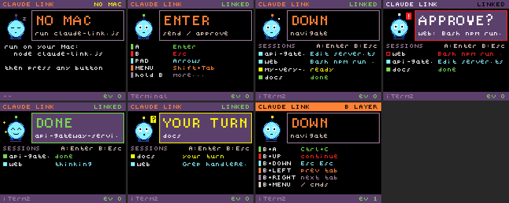
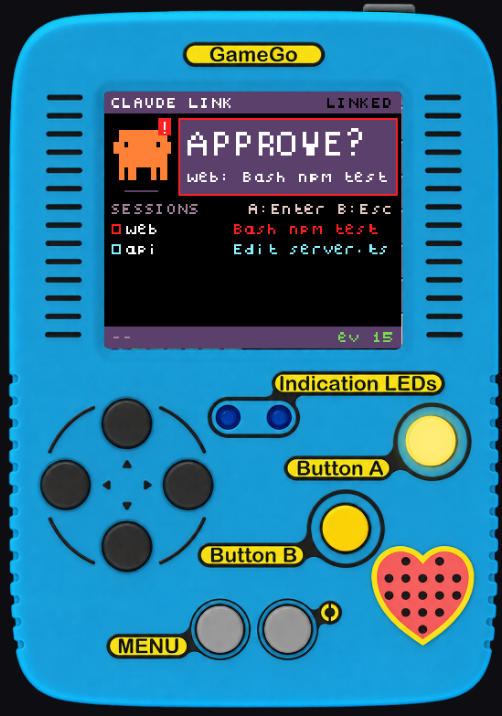

# Claude Link — GameGo controller for Claude Code / Codex

A TinkerGen GameGo becomes a game-style controller for your Claude Code / Codex sessions:
buttons drive the terminal, the screen shows live session state with an animated buddy.
Full background, design and protocol notes: **[docs/SESSION-HANDOFF.md](docs/SESSION-HANDOFF.md)**.

## Setup
1. Flash `claude-link.uf2` onto the GameGo (drive mode, drag the file on).
2. `npm install`
3. `node install-hooks.js` (once; undo with `--uninstall`), then restart your Claude sessions.
   - In Codex, open `/hooks` and review/trust the new claude-link hooks.
4. `node claude-link.js` (`--dry-run --verbose` to debug without sending keys)
   - Allow your terminal to control **System Events**, and add it under
     **System Settings → Privacy & Security → Accessibility**.

## Codex monitoring
Run only one helper at a time. A second launch exits if the hook port is already in use,
before opening USB. Stop the existing helper with Ctrl+C before restarting it.

The helper automatically discovers recently active local Codex sessions from
`$CODEX_HOME/sessions` (default `~/.codex/sessions`), including sessions already running.
It polls activity every two seconds and discovers new sessions within ten seconds.
Rows start with `C:` and use Codex's saved thread title, or a folder plus a short thread ID.
Separate threads in the same folder stay separate; internal subagents are excluded.

Run `node install-hooks.js --codex-only` to install Codex's native lifecycle hooks,
then review them with `/hooks` and restart/resume your sessions. These add prompt/tool
activity, approval alerts, completion, interruption, and session closure. Your existing
`notify` command (including Computer Use) is preserved. [Codex hook documentation](https://learn.chatgpt.com/docs/hooks).

Without trusted hooks, local transcripts still provide working/done/interrupted and
input-request states, but approval alerts are best-effort. Only sessions active in the
last three hours are shown, with up to five rows shared with Claude. Transcript formats
are internal and may change; remote sessions without local logs are not discovered.

## Screen mirror (for demos)
While `node claude-link.js` runs, open **http://127.0.0.1:47821/mirror** in Chrome or Safari.
It runs the same GameGo program in MakeCode's simulator, fed live with the same Claude state,
mascot and your real button presses (the on-screen buttons light up). Use it to project the
screen or record clean video instead of filming the device.

The device frame uses a transparent cutout of your front-view GameGo photo, with the wrist
strap, white background and shadow removed: blue portrait casing, four separate
direction buttons, yellow A/B buttons, grey Menu/Reset pair, LEDs, and heart-shaped speaker.
The live screen replaces the photographed LCD, and all seven reported buttons light up
at their real positions. Reset remains decorative because it sends no button event.
Device-view PNG snapshots preserve the transparent background; video formats may render it black.

- **R** record / stop (saves an `.mp4` or `.webm` of just the stage) · **S** snapshot PNG
- **V** device frame ↔ screen only · **H** hide the toolbar (clean view for OBS / projector) · **F** fullscreen · **M** sound
- The mirror works even without the GameGo plugged in (handy for rehearsing).

## Controls (edit `config.json`; reloads live)
| Button | Action | | Hold B + | Action |
|---|---|---|---|---|
| A | Enter | | A | Ctrl+C |
| B tap | Esc | | UP | types `continue` + Enter |
| D-pad | Arrows (repeat) | | DOWN | Esc Esc (rewind) |
| MENU | Shift+Tab (mode) | | LEFT / RIGHT | prev / next terminal tab |
| | | | MENU | `/` slash commands |

## Screen
- **APPROVE?** (red, beep) — a session wants permission, with the tool + command
- **DONE** (chime) / **YOUR TURN** — a session finished / is waiting for you
- **SESSIONS** — each session's name (follows `/rename`) and live state
- **Clawd** — Claude Code's orange mascot, with animated movement and mood effects. Replace it with your own art:
  drop PNGs into `mascot/` (see [mascot/README.md](mascot/README.md)); uploads live, saved on the device.
- Top-right: `LINKED` / `NO MAC` (start the helper) / `NO USB` (cable)

## Folder
| | |
|---|---|
| `claude-link.js`, `codex-sessions.js`, `mascot.js`, `keys.jxa.js`, `install-hooks.js`, `config.json` | Mac helper |
| `firmware/` | GameGo source + `build.sh` to rebuild `claude-link.uf2` |
| `mascot/` | your custom mascot PNGs |
| `images/` | screenshots of every screen state |
| `tests/` | simulated-device tests (`run-all.sh`) |
| `tools/sim-preview/` | render the screen in MakeCode's simulator |
| `legacy/` | earlier attempts (USB keyboard firmware, USB diagnostic) |
| `mirror/` | browser screen mirror (simulator runtime + compiled program) |
| `docs/` | session handoff / design notes |
